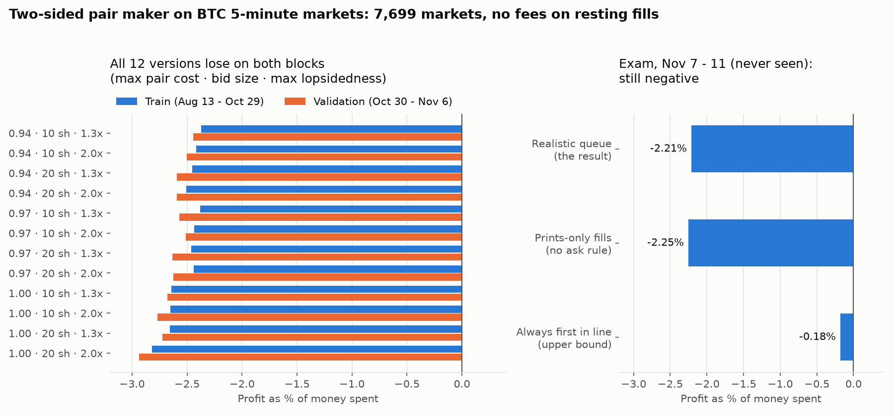
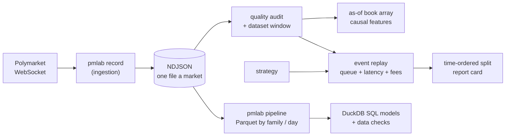

# polymarket-microstructure

[](https://github.com/noocklasss/polymarket-microstructure/actions/workflows/ci.yml)


Tools to record the order books of Polymarket's 5- and 15-minute crypto "Up or Down" markets, check the recordings,
and test trading strategies on them honestly: with no look-ahead, a queue-position fill model and a time-ordered exam on
markets the strategy has never seen.

The worked example is a negative result. **A textbook two-sided "pair maker" loses 2.2% of the money it spends** on
1,424 never-seen BTC 5-minute markets, and the report explains why (adverse selection).



## What is in here



| Part | What it does |
|---|---|
| **Recording** (`pmlab.ingestion`) | One recorder for 16 market families (6 coins x 5m / 15m, plus gold and silver 15m / 1h). It looks up each market before it opens, keeps both order books in sync from WebSocket events (rebuilding from a REST snapshot after a gap), and writes one NDJSON file per market: every book change, every trade, and a 5-level snapshot each second. |
| **Pipeline** (`pmlab.pipeline`) | Incremental extract of the recordings into Parquet (one file per table, family and day; only new or changed days are rebuilt), SQL models in DuckDB (per-second books, per-market and per-day summaries) and SQL data checks that fail the run. See [below](#data-pipeline). |
| **Data checks** (`pmlab.data`) | A fixed research window (markets from Aug 1, 2026), only final results count (payouts exactly 1 / 0), a quality audit that drops recordings with stale books, and an as-of per-second book array built only from messages received up to that second. |
| **Features** (`pmlab.features`) | Causal per-second market features. A test changes the future of a recording and checks that no past value moves. |
| **Backtest** (`pmlab.backtest`) | Event-by-event replay for resting orders: place / cancel / take latency, position in the queue, fills from trade prints or when the ask comes down to the bid, the taker fee. Plus the time-ordered train / validation / exam split and a report card. |
| **Strategies** (`pmlab.strategies`) | A small interface (`t0`, `t1`, `step(state)`) and the demo pair maker. |

## The study: does "buy both sides for under $1" work?

Exactly one side pays $1, so owning one UP and one DOWN share for less than $1 combined should be risk-free. The
[report](reports/pair_maker_btc_5m.md) tests it the way a strategy should be tested before real money goes in:

* **7,699 markets** (Aug 13 - Nov 11, 2026), split **in time order** on whole days: train, then validation, then an exam
  on the last five days, opened once.
* **12 versions fixed in advance**; the best 3 on train are ranked on validation, and only the winner sees the exam.
* **A second simulator**, written separately and deliberately optimistic (always first in the queue), as a cross-check.

| Exam, Nov 7 - 11 (1,424 markets) | |
|---|---|
| Profit | **-$4,444 on $200,770 spent (-2.21%)**, 0 of 5 days up |
| Fills from trade prints only | -2.25% |
| Optimistic simulator (upper bound) | -0.18% |

**Why it loses:** the bot ends almost perfectly balanced, but the median pair costs **$1.021** for a $1 payout. A
resting bid fills when someone is in a hurry to sell, which is usually just before the price drops: in the
[notebook](notebooks/01_inside_one_market.ipynb), the side just bought is on average 2c cheaper 30 seconds later.

## Quickstart

Needs Python 3.12+. The repository includes a small sample (4 real markets, about 1 MB), so nothing has to be recorded
to try it.

```bash
git clone https://github.com/noocklasss/polymarket-microstructure.git
cd polymarket-microstructure
python3 -m venv .venv
.venv/bin/pip install -e ".[dev,research]"
.venv/bin/pytest                      # 98 tests, a few seconds
.venv/bin/jupyter lab notebooks/      # the walkthrough of one market
```

Record live markets (Ctrl+C to stop):

```bash
.venv/bin/pmlab families              # the 16 market families
.venv/bin/pmlab record btc_5m         # every BTC 5-minute market, into ./data/btc_5m_data/
```

Or run the recorder in Docker, with no Python setup (recordings land in `./data` on your machine):

```bash
docker build -t pmlab .
mkdir -p data                         # create it yourself, or Docker creates it owned by root
docker run -d --name btc_5m --restart unless-stopped -v "$PWD/data:/app/data" pmlab record btc_5m
docker logs -f btc_5m
```

Rerun the full study (needs your own recordings and a file of final results; about 10 minutes on 6 cores):

```bash
.venv/bin/python experiments/pair_maker_btc_5m.py --data-dir data --outcomes outcomes.json
.venv/bin/python experiments/crosscheck_pair_maker.py --data-dir data --outcomes outcomes.json
```

## Data pipeline

Raw recordings are good for replaying a market, not for asking questions across thousands of them. `pmlab pipeline`
turns them into a small SQL warehouse:

```bash
.venv/bin/pmlab pipeline --data-dir data --warehouse warehouse --outcomes outcomes.json
.venv/bin/pmlab sql "SELECT day, markets, with_result, round(volume_usd) AS usd, median_coverage FROM daily_summary"
```

1. **Extract** (Python): each recording is read once and split into five Parquet tables (`markets`, `trades`, `book`,
   `snapshots`, `resyncs`), one file per table, market family and New York day. A manifest remembers which recordings
   built each day, so a rerun only rebuilds days that changed, and markets still in progress wait for the next run.
   Files are written under a temporary name and renamed, so a crash never leaves half a day behind.
2. **Models** (SQL, [`src/pmlab/pipeline/sql/models`](src/pmlab/pipeline/sql/models)): `markets` joined to final
   results; `book_seconds`, the as-of top of book for every second of every market, built with an `ASOF JOIN`;
   `market_summary` (trades, volume, VWAP, how much of the market both books were fresh) and `daily_summary`.
3. **Checks** (SQL, [`src/pmlab/pipeline/sql/checks`](src/pmlab/pipeline/sql/checks)): each is a query that returns
   the rows breaking a rule. `error` checks (duplicate markets, a market from before the research window, impossible
   trade prices, a recording without its market description) fail the run; `warn` checks (missing results, gaps in a
   recording, cut-off lines) are reported.

`book_seconds` is tested to be identical, value for value, to the Python loader the backtests use, so research done in
SQL and research done in Python see the same market.

On the BTC 5-minute recordings (17 GB of NDJSON, Aug 13 - Nov 13, 2026) a full build takes **under 2 minutes** on 4
cores and gives a **1.1 GB** warehouse: 8,398 markets on 41 recorded days, 12.2 million trades, 28.5 million book
changes, and 5.0 million market-seconds in `book_seconds`. All error checks pass; the coverage warning flags 891
recordings with gaps.

## Repository layout

```
src/pmlab/              the package: ingestion, data, features, backtest, strategies, cli
  config/markets.toml   the market families the recorder knows
experiments/            scripts that produce the reports
reports/                the pair-maker write-up, chart, and every number behind it
notebooks/              a walkthrough of one market
data/sample/            4 recorded markets and their results (data/README.md describes the file format)
tests/                  unit tests, including one that the sample reproduces the study's numbers exactly
Dockerfile              the recorder in a container (runs as a normal user, data in a mounted folder)
.github/workflows/      CI: lint and tests on Python 3.12 and 3.13, and a build and smoke test of the image
```

## Choices worth knowing

* **The exam is in time order, never shuffled.** Markets on the same day share the same price moves; a random split
  would let the strategy be tuned on days it is later tested on.
* **Resting orders are filled conservatively.** A new order joins the back of the queue and fills only once the shares
  ahead of it have traded. The optimistic simulator shows how much this matters: -0.18% against -2.21%.
* **Everything is checked twice.** Each module was compared with an older implementation on real recordings before it
  replaced it, and the headline result is rerun in a simulator that shares no fill code with the main one.

## Limitations

* The study covers one market family (BTC 5m) over three months.
* The fill model is a model: it cannot know how other traders would have reacted to our orders.
* Recordings come from one machine and one connection; the quality audit removes the markets where it fell behind.
