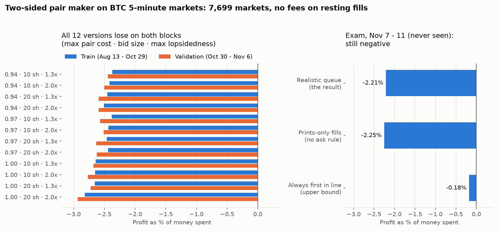

# Does "buy both sides for under $1" work? A pair maker on BTC 5-minute markets

**No.** On 7,699 recorded BTC 5-minute markets, every one of 12 versions lost money on both the training and the
validation block, and the chosen version lost **-2.21% of the money it spent** on five days it had never seen. Even a
deliberately optimistic simulator, where our orders are always first in line, loses.



## The idea

Each market pays $1 to exactly one side, UP or DOWN. Own one share of each for less than $1 combined and you make the
difference whatever happens. The strategy (`pmlab.strategies.pair_maker`) rests small buy orders on both sides at the
best bid, only adds to the heavier side while the pair stays under a target cost, and keeps buying the lighter side to
complete pairs. Resting orders pay no fee, so any edge would be kept in full.

## Method, fixed before looking at any result

| | |
|---|---|
| Markets | Every recorded BTC 5m market, Aug 13 - Nov 11 2026, with a final official result and a recording that passes the quality audit: **7,699** used (193 left out for recording gaps, 380 with no final result yet) |
| Split | In time order, on whole days, never shuffled. **Train** Aug 13 - Oct 29 (4,772 markets), **Validation** Oct 30 - Nov 6 (1,503), **Exam** Nov 7 - 11 (1,424) |
| Versions | 12, fixed in advance: max pair cost 94c / 97c / 100c x bid size 10 / 20 shares x max lopsidedness 1.3x / 2x |
| Choice | Best 3 on Train, ranked on Validation; the winner run once on the Exam |
| Fills | Event-by-event replay with queue position (`pmlab.backtest.resting_engine`). A bid also fills when the ask comes down to it, as it would have if we had really been there |
| Cross-check | A second simulator written separately (`experiments/crosscheck_pair_maker.py`): one decision a second, no queue, every touch fills the whole order. An upper bound |

## Exam report card (Nov 7 - 11, chosen version: 94c max pair cost, 10 shares, 1.3x)

| | |
|---|---|
| Markets entered | 1,424 of 1,424 |
| Money spent | $200,770 ($140.99 a market) |
| Profit (no fees on resting fills) | **-$4,444 (-2.21%)** |
| Markets won / lost | 106 / 1,294 |
| Days up | 0 of 5 (every day between -$776 and -$973) |
| Worst stretch | $4,445, 31.5x the average spend in a market |

| Same exam markets | Profit |
|---|---|
| Realistic queue (the result) | -2.21% |
| Fills from trade prints only (no "ask comes down" rule) | -2.25% |
| Optimistic simulator: always first in line, filled in full | -0.18%, still 0 of 5 days up |

## Why it loses

The bot ends almost perfectly balanced: 50.2% of its shares are on the losing side. The problem is the price. **The
median pair costs $1.021 for a $1 payout.** The first buy goes on whichever side is cheap; a resting bid on that side
fills because sellers are leaving it, which is usually the start of a move against it. To complete the pair the bot then
has to buy the other side, which has just become more expensive. This is adverse selection: a resting order is filled
most readily exactly when filling it is a bad trade.

The gap between the optimistic simulator (-0.18%) and the realistic one (-2.21%) is the cost of standing in the queue:
when other buyers are already waiting at the same price, our order fills mainly when the price goes through all of them.

## Reproduce

```bash
python experiments/pair_maker_btc_5m.py --data-dir data --outcomes outcomes.json   # about 10 minutes on 6 cores
python experiments/crosscheck_pair_maker.py --data-dir data --outcomes outcomes.json
python experiments/plot_pair_maker.py
```

`pair_maker_btc_5m.json` holds every version's Train and Validation numbers; `pair_maker_btc_5m_exam_markets.csv`
holds one row per exam market.
